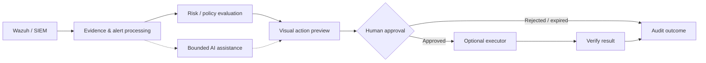

# ESOVAI BURHWARD
### Human-Centered Incident Response · Controlled AI Assistance · Security Engineering

**A public engineering case study about turning SIEM alerts into reviewable, risk-aware incident-response workflows.**

  

> **Case-study scope:** This repository is a sanitized public preview, **not** the source code of a production-ready SOC and not proof of complete end-to-end execution. Screenshots and test evidence are added only after review.

## At a glance

| Problem | Engineering response |
| --- | --- |
| Security teams receive fragmented, high-volume SIEM alerts. | Structure alert context and make evidence reviewable. |
| Automation can act faster than human oversight. | Show a visual action preview and introduce explicit human approval gates. |
| Generative AI can hallucinate or follow malicious instructions in logs. | Keep AI in a bounded explanatory role; use deterministic policies for authority. |
| Approvals are not the same as completed remediation. | Model execution, verification and outcome auditing separately. |

## Why I built this

I wanted to explore a practical question in modern security operations: **How can we use AI to assist analysts without handing it unchecked control of sensitive infrastructure?**

BURHWARD brings together software engineering, SOC workflows and secure-by-design thinking. The work includes a React/Vite user interface, a Node.js backend and a test-oriented engineering workflow. The private implementation is intentionally not copied into this public repository.

## Architecture



*Conceptual design: not every element is integrated or production-verified.*

[Architecture deep dive](docs/architecture.md) · [Security model](docs/security-model.md)

## Core engineering themes

- **Human-in-the-loop:** decision points for potentially disruptive security actions.
- **Visual Action Preview:** explain intended response effects before an analyst makes a decision.
- **Deterministic classification:** critical policy boundaries must not depend solely on generative text.
- **Defensive AI integration:** treat model output and SIEM content as untrusted inputs.
- **Auditability:** distinguish event evidence, authorization and measured action outcome.
- **Test-driven validation:** independent unit, backend, contract, boundary and E2E test infrastructure.

These points describe the architecture and engineering scope; see the [limitations](docs/limitations.md) for incomplete integrations.

## Technology stack

| Area | Technologies observed in the private engineering repository |
| --- | --- |
| Frontend | React, Vite, React Router, Tailwind CSS |
| Backend | Node.js |
| Data | PostgreSQL client (`pg`) |
| Testing | Node.js test runner, Playwright, ESLint |
| Security operations context | Wazuh / SIEM-oriented workflow design |

No claim is made that the full chain is deployed and production-ready.

## Case study: From alert to accountable response

A safe, **synthetic** example demonstrates the reasoning process:

1. **Detection / recon:** a fictional authentication alert appears in the SIEM pipeline.
2. **Evidence:** classify observed data separately from speculation.
3. **AI assistance:** offer bounded context and an explanation, not permission to act.
4. **Action preview:** show what a proposed response could change.
5. **Human approval:** require a valid decision; escalation or rejection remains possible.
6. **Verification:** if an authorized executor is present, confirm the actual result.
7. **Report:** record the action decision, measured outcome and limitations.

[Read the example workflow](docs/workflow-example.md) · [Synthetic alert JSON](examples/synthetic-alert.json)

## Screenshots — evidence-first gallery

Four redacted images from the isolated LuxVPS portfolio build have been prepared for publication. **The binary images are not yet committed to this repository.** Once uploaded to `assets/screenshots/`, they can be embedded here in this recommended order:

| Order | Filename | What the image actually shows |
| --- | --- | --- |
| 1 | `wazuh-integration.png` | Stored Wazuh alert evidence displayed via demo ingestion; rule 5712, level 10. This does **not** demonstrate a completed Wazuh-to-executor chain. |
| 2 | `dashboard.png` | Mission Control incident queue and severity summary. Sensor connection remains unavailable; an incident remains unclassified. |
| 3 | `action-preview.png` | Deterministic **synthetic, non-executed** action preview with scope, TTL, evidence and proposed effects. |
| 4 | `alert-detail.png` | Synthetic Evidence-First investigation: observed fact, illustrative AI interpretation and prediction are explicitly separated. |

The screenshot set is derived from the **portfolio build**, rather than the unchanged original QA preview. A fifth approval fixture image has not been approved for publication because approvals and auditing are not integrated.

[Preparation and provenance](assets/screenshots/README.md)

## Evidence & testing

The private repository defines scripts for unit, backend, database, contract, boundary, QA and end-to-end tests. In the isolated LuxVPS portfolio-polish run, the executing agent **reported 345/345 unit tests passing, ESLint passing and successful default/portfolio builds** (worktree commit `0d1c55b`). These are **agent-reported results, not independently rerun by this portfolio repository**. Playwright E2E tests were **not run** in that pass. There is no claim of production end-to-end readiness.

[Testing and validation](docs/testing-validation.md)

## Engineering lessons

1. **A UI approval is not an authorization boundary.** Authorization belongs at the privileged backend action.
2. **A proposed mitigation is not a verified outcome.** Evidence and outcome verification must be distinguished.
3. **Generated analysis is not trusted evidence.** Models can explain signals but cannot independently certify them.
4. **Integration gates matter.** Isolated test success does not imply a functioning production incident-response chain.
5. **Good security documentation includes limitations.** Missing role binding, step-up or executor auditing must remain explicit.

## Current limitations

The broader private engineering effort has remaining tasks involving bridge-side integration, operational verifier/loader behavior, role binding and revocation, step-up enforcement and executor outcome auditing. This public showcase does not misrepresent those controls as complete.

[Full limitations](docs/limitations.md) · [Portfolio roadmap](docs/roadmap.md)

## Repository guide

```text
README.md                      Main case study
SECURITY.md                    Responsible reporting and publication policy
.gitignore                     Sensitive and generated file exclusions
docs/
  architecture.md              High-level design
  security-model.md            AI and authorization boundaries
  testing-validation.md        Evidence policy and known test tooling
  workflow-example.md          Synthetic incident walkthrough
  limitations.md               Open integration risks
  roadmap.md                   Planned portfolio deliverables
  profile-and-linkedin.md      Professional sharing copy
assets/
  screenshots/README.md        Authentic evidence capture checklist
  thumbnail/README.md          Thumbnail specification
examples/
  synthetic-alert.json         Fictional input example
```

## Next portfolio additions

- [ ] Create and add a distinctive BURHWARD cover image.
- [ ] Capture and redact genuine screenshots from the private demo.
- [ ] Document a real, authorized, scoped demo/test run with exact results.
- [ ] Review writing and visuals for accuracy.
- [ ] Pin this repository on the GitHub profile; optionally share a condensed LinkedIn case study.

[Sharing text](docs/profile-and-linkedin.md)

## Scope, license and disclosure

The original BURHWARD source repository remains private. This separate repository contains newly written documentation and a fictional example, **not private source, credentials, logs or commit history**. No open-source code license has been granted yet; do not assume reuse rights.

**Portfolio purpose:** demonstrate the engineering decisions and security thinking behind an ongoing AI-assisted incident-response project.
