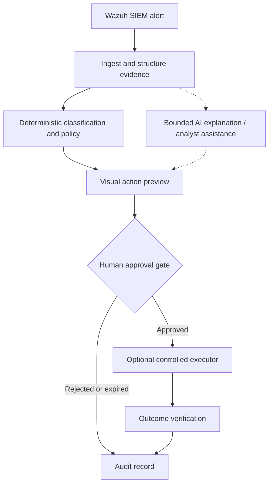

# Architecture

This is a **conceptual public overview**. Components differ in implementation and integration maturity.

## Separation of concerns
- **Alert and evidence**: retain context and provenance.
- **Deterministic policy**: model output is never a security authorization.
- **Visual preview**: make intended actions understandable before approval.
- **Approval**: high-risk decisions require stronger human oversight.
- **Executor and verifier**: optional action path, subject to independent authorization and outcome checks.
- **Audit**: capture decision and observed result, not just a button click.

## Current boundary
The private project has frontend, backend and testing infrastructure. Full production bridge integration, role binding, step-up verification, and executor outcome auditing **must not be assumed complete**. See [limitations](limitations.md).
